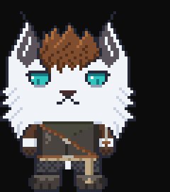

# terminal-pet

A hand-drawn pixel-art pet that lives beside your Claude Code conversation and reacts to what
Claude is doing. It works along while Claude works, hops when a turn finishes, startles at an
error, tosses its dagger now and then while idle, and falls asleep after five quiet minutes.



The built-in pet is **Shiro**, a white lynx. The plugin also comes with the `pixel-pet` skill, which
Claude uses to draw a new pet with you from a reference image, pixel by pixel, in the same style.

## Install

At the prompt of a Claude Code session in a terminal:

```
/plugin install terminal-pet --marketplace BMNHunter/Terminal-Pets
```

Answer `y` to add the marketplace, then pick a scope (user is the usual one). The pet appears right
away, in a narrow pane beside the conversation in the fullscreen layout, or above the prompt
otherwise.

## Use

| Command | What it does |
| --- | --- |
| `/pet` | show or hide the pet |
| `/pet corner` · `/pet band` | a side pane, or a row above the prompt |
| `/pet auto` · `big` · `small` · `head` | size; it steps down when the room is short |
| `/pet clothes` · `/pet tricks` | the outfit, and when the dagger flies |
| `/pet bg #rrggbb` | the side pane's fill: set it to your terminal's background |
| `/pet list` · `/pet <name>` | the pets you have, and switching between them |
| `/pet help` | everything, with the current settings |

The same settings are rows in `/config`, under "Pet:".

## Draw your own pet

Ask Claude for a new pet, or run `/terminal-pet:pixel-pet`, and give it a reference image, a name,
and the three to five features that matter most. Claude draws a small sprite first and shows it next
to your reference, then a big one, a head-only one, and an outfit if the reference has one.

Your pets live in `~/.claude/pets/<name>/`, outside the plugin, so updates never touch them. Once a
pet is built, `/pet <name>` switches to it, with no restart.

The drawing tools need **Python 3 with Pillow** (`python -m pip install pillow`).

## Develop

```
claude --plugin-dir .                                   # a session with this folder's mod loaded
claude plugin validate .
claude plugin test .
python skills/pixel-pet/tools/make_frames.py --builtin .  # rebuild hooks/sprites.ts from pets/
```

| Path | What |
| --- | --- |
| `hooks/register.tsx` | the mod: moods, animation, the pane and band, `/pet` |
| `hooks/sprites.ts` | the built-in pets' frames, generated from `pets/` (do not edit) |
| `hooks/pets.ts` | reads the pets you drew (`~/.claude/pets/*/frames.json`) |
| `pets/shiro/` | Shiro's hand-drawn sprites, `pet.json` and outfit script |
| `skills/pixel-pet/` | the drawing skill and its tools (`render.py`, `make_frames.py`, `acts.py`) |
